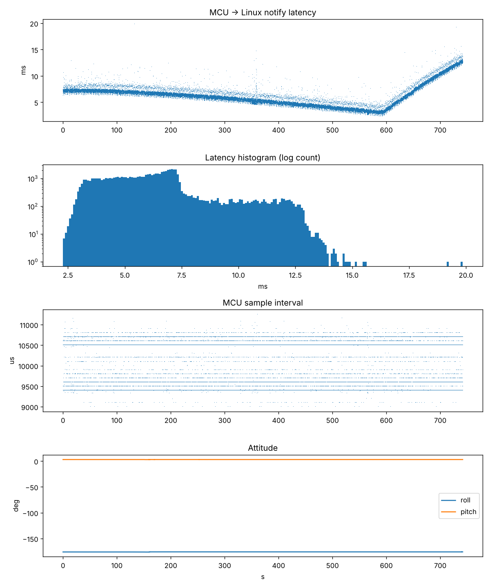
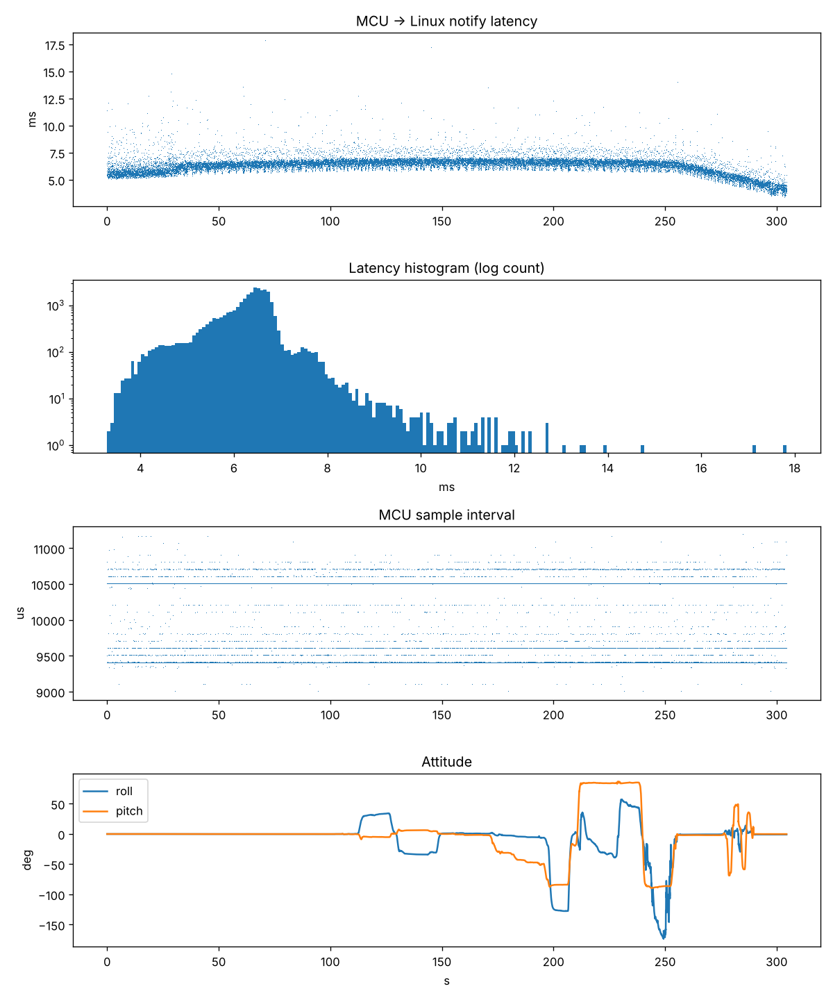
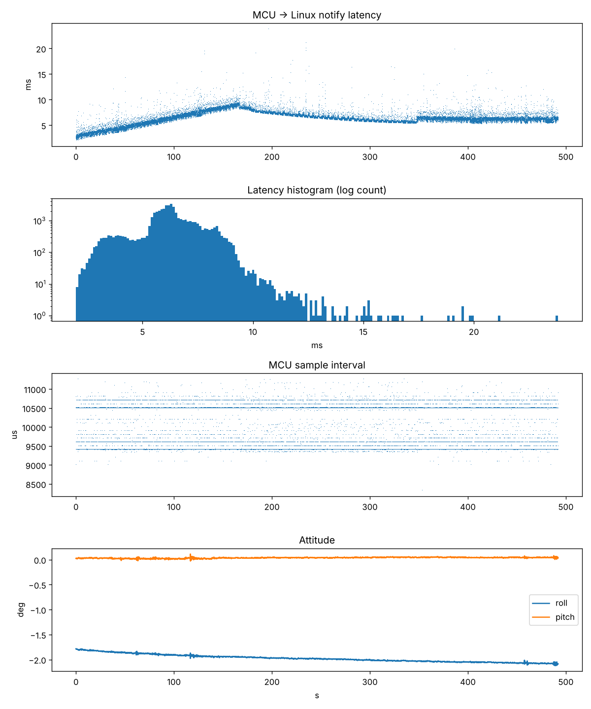

# Exp01 — IMU Bridge Latency

**Part of [Humanoid](../../README.md): a from-scratch, 29-joint bipedal humanoid robot.**
*Built by Hand. Bound for Space.*

How fast, and how predictably, can the real-time microcontroller and the Linux processor talk to each other on an Arduino UNO Q? The answer decides which parts of the robot's control system must live on the microcontroller and which can live on Linux.

| | |
|---|---|
| **Date** | October 18, 2026 |
| **Hardware** | Arduino UNO Q (STM32 MCU + Linux MPU), Arduino Modulino Movement (LSM6DSOX 6-axis IMU) over Qwiic |
| **Software** | Arduino App Lab, `Arduino_RouterBridge`, `Arduino_Modulino` 0.10.0 |
| **Status** | ✅ Complete: 3 runs, 153,808 samples, 0 dropped |

---

## Key findings

1. **MCU → Linux latency is about 6 ms typical, 8–12 ms in the worst 1%, and 23 ms at the very worst.** A Linux → MCU → Linux round trip is about 10 ms.
2. **Anything that must react faster than about 20 ms stays on the microcontroller.** That means balance, joint control and the e-stop. Linux handles the slower layers at 10–50 Hz: planning, vision, voice and the LLM agent.
3. **A fully loaded Linux CPU barely matters.** With all four cores at 100%, typical latency rose by only 0.4 ms. The microcontroller dropped zero samples.
4. **The MCU clock runs about 0.09% slow** relative to Linux (≈920–980 ppm), and the rate shifts slightly as the board warms. The two sides need periodic clock sync, and the ping-based method used here works.
5. **The IMU needs Block Data Update (BDU) enabled.** Without it, the gyro produced occasional single-sample false spikes of exactly ±15.6 °/s (a 256-LSB byte tear). With BDU on, there were zero spikes in 49,000 samples.
6. **Roll/pitch angles break down near 90° (gimbal lock).** The robot's real attitude estimator should use quaternions, for example a Madgwick or Mahony filter.

### Engineering skills demonstrated

- **Embedded real-time C++:** a fixed-rate scheduler on an STM32, sensor fusion with a complementary filter, and gyro bias calibration
- **Register-level debugging:** traced a rare gyro glitch to a byte tear in the IMU's data registers and fixed it over I²C (`CTRL3_C` BDU bit), with read-back verification
- **Distributed timing:** NTP-style clock offset and drift estimation between two processors, for true one-way latency
- **Experimental method:** baseline, motion and stress runs, controlled variables, and raw data published alongside conclusions
- **Data analysis in Python:** pandas and NumPy statistics (percentiles, drift fits, phase segmentation) and matplotlib reporting

---

## How it works

```
 MCU (STM32, real-time)                         Linux (Python)
 ───────────────────────                        ──────────────
 100 Hz fixed-rate loop                         logs every sample + arrival time
   read IMU → complementary filter   ──notify──▶   imu_<time>.csv
   stamp with MCU micros()
                                     ◀──call───  ping() 5×/s
   ping(): return micros()           ───reply──▶   ping_<time>.csv
```

- **Latency, not just round-trip time.** The two processors have separate clocks. The pings work like NTP: the lowest-round-trip pings estimate the clock offset and drift, which converts each sample's MCU timestamp into Linux time. One-way latency is the arrival time minus the converted send time. The offset estimate is accurate to about ±2 ms, half the minimum round trip.
- **Stable Bridge contract.** The sketch exposes `ping`, `get_stale_count` and `get_bdu_status`, and sends `imu` notifications. These names are meant to carry over unchanged to the production controller.

## Results

### Run 1: still (12.4 min, 74,161 samples)

| Metric | Value |
|---|---|
| Sample rate | 100.00 Hz (MCU clock), 0 dropped |
| Notify latency p50 / p99 / max | 6.06 / 12.39 / 19.86 ms |
| Round trip p50 / p99 / max | 9.96 / 11.35 / 16.20 ms |
| Attitude drift | < 0.2° over 12 min |

The sensor was mounted upside down for this run, so roll reads about −176°. That doesn't affect the timing results. It was flipped for runs 2 and 3.



### Run 2: tilt (5.1 min, 30,443 samples)

The board was tilted by hand to about ±30° on roll, stepped through −31°, −43° and −47° on pitch, stood on edge, then shaken hard (peaks around 600 °/s).

- Roll and pitch tracked cleanly and settled within about 2 s of each tilt.
- It recovered to within 1° of level in under a second after hard shaking.
- Near ±85–90° pitch, roll became meaningless, which is expected gimbal lock.
- Latency was the same as run 1: 6.40 ms p50, 8.15 ms p99.



### Run 3: Linux under full CPU load (8.2 min, 49,204 samples, BDU enabled)

All four cores were loaded with `yes > /dev/null` for about 2¾ minutes in the middle of the run.

| Phase | Latency p50 | p99 | Max | Round trip p50 | Max |
|---|---|---|---|---|---|
| Before load | 6.14 ms | 8.12 ms | 18.1 ms | 9.92 ms | 14.0 ms |
| **Under load** | **6.56 ms** | **8.42 ms** | **22.9 ms** | **9.38 ms** | **18.7 ms** |
| After load | 6.29 ms | 8.68 ms | 19.8 ms | 9.93 ms | 15.7 ms |

Load added about 5 ms to rare worst-case spikes and almost nothing to the typical case. The round trip was slightly *faster* under load, most likely because the CPU stays at full clock speed. MCU timing was unchanged, and there were zero gyro spikes.



> **Caveat:** `yes` stresses only the CPU. Vision workloads also load memory bandwidth and USB, so latency will be re-measured once camera work starts.

## Other observations

- **The MCU loop period alternates between about 9.4 ms and 10.5 ms,** averaging exactly 10 ms. That's fine at 100 Hz, but a 500–1,000 Hz balance loop will need a hardware timer rather than polling `micros()`.
- **The console's live rate reads 99.9 Hz, not 100,** because of the MCU clock offset. The analysis uses MCU timestamps and sequence numbers instead.

---

## Repository layout

```
sketch/sketch.ino            MCU sketch (v2, with BDU fix): used for run 3
sketch/archive/sketch_v1.ino MCU sketch v1: used for runs 1 and 2
python/main.py               Linux-side logger (App Lab Python)
analysis/analyze.py          Offline analysis, run on a PC
data/run*/                   Raw CSV logs for each run
results/                     Analysis plots for each run
```

The run 1 file timestamp (`130053`) is in UTC, equal to 08:00 Central. The Central time-zone setting was added to `main.py` before run 2.

## Reproduce it

1. In Arduino App Lab, create an app, paste `sketch/sketch.ino` and `python/main.py`, and add the **Arduino_Modulino** library.
2. Connect the Modulino Movement via Qwiic, mount it flat with the chip up, and click **Run**. Keep it still for 2 s for gyro calibration. The console should print `BDU status: ON`.
3. Copy the `imu_*.csv` and `ping_*.csv` files from the app's `python/logs/` folder.
4. On a PC, run:
   ```
   pip install pandas numpy matplotlib
   python analysis/analyze.py imu_<time>.csv ping_<time>.csv
   ```

## CSV format

**imu_*.csv**: `seq, mcu_us, linux_ns, roll, pitch, gx, gy, gz`. `mcu_us` is MCU `micros()`, which wraps at 2³², and `linux_ns` is Linux `time.monotonic_ns()` at arrival. Angles are in degrees and rates in °/s.

**ping_*.csv**: `t0_ns, t1_ns, mcu_us`. These are the Linux times before and after `Bridge.call("ping")`, plus the MCU time it returned.

---

*Next: Exp02, voice command pipeline (planned). See the [experiments index](../README.md).*
